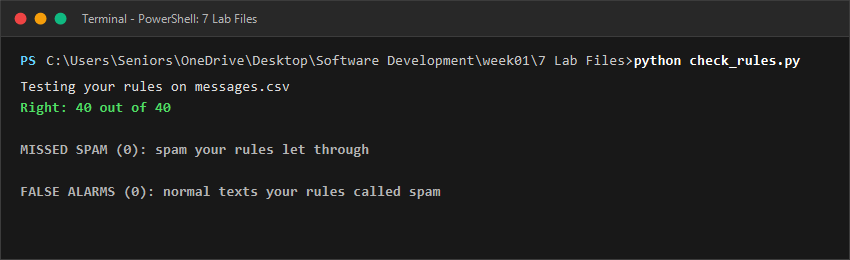
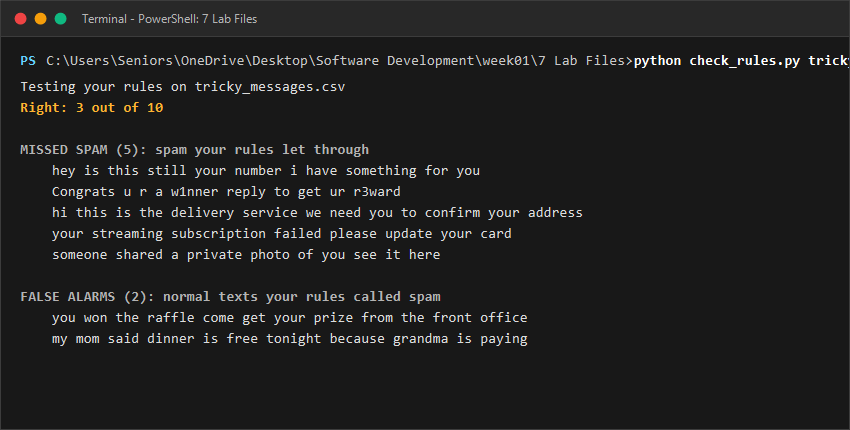

# MCCTC | 145130 Applications of AI
## Assignment 3: Build a Spam Filter With Rules
**Week 1 · Wednesday and Thursday · 40 points**  
**Name:** ______________________________ &nbsp;&nbsp;&nbsp;&nbsp;&nbsp;&nbsp;&nbsp;&nbsp; **Date:** November 18, 2026  
*40 points · Wednesday and Thursday · No AI tools for this lab.*

---

### Why you are doing this
Every phone has a spam filter. Before you can understand how AI catches spam next week, you are going to build a spam filter the old way, with rules you write yourself. Then you will watch it break.

### What you need: the 7 Lab Files folder
| File | What it is | Do you change it? |
|---|---|---|
| `spam_rules.py` | Your spam filter. Your rules go here. | **Yes** |
| `check_rules.py` | Tests your rules and gives you a score | **No** |
| `messages.csv` | 40 text messages, each marked spam or not spam | **No** |
| `tricky_messages.csv` | 10 harder messages for Part 2 | **No** |

---

## Part 1 · Wednesday: Build the filter (24 points)

### Step 1: Open the folder and a terminal
All four files are located in `7 Lab Files`. Commands are executed from inside this directory.

### Step 2: Run the starter and read the score
Running `python check_rules.py` on the starter code gives:
```text
Testing your rules on messages.csv
Right: 25 out of 40

MISSED SPAM (15): spam your rules let through
    CONGRATULATIONS you have been selected to win a free gift card claim now
    URGENT your account has been locked click the link to verify your password
    You are a WINNER claim your cash prize today before it expires
    FREE iPhone for the first 100 people who reply YES
    ...
```

> **Answer in the box (2 points): A filter that says not spam for every message got 25 out of 40. Is that a good spam filter? Why or why not?**
>
> **No, it is not a good spam filter.** Even though 25 out of 40 (62.5%) looks like a passing percentage, this is an illusion caused by dataset imbalance: 25 of the 40 test messages happened to be legitimate, normal texts. A spam filter's sole job is to catch spam, yet this baseline filter caught 0 out of 15 spam messages (a 100% failure rate on spam). A spam filter that allows every single scam and unwanted message into your inbox is completely ineffective.

---

### Step 3: Write your first rule
We add the first rule to `spam_rules.py`:
```python
def is_spam(message):
    """Return True if the message is spam. Return False if it is not."""
    text = message.lower()
    # ----- STEP 3: write your first rule below this line -----
    if "winner" in text:
        return True
    # ----- add more rules above this line -----
    return False
```
Running `python check_rules.py` now results in:
`Right: 26 out of 40` (the spam message *"You are a WINNER claim your cash prize today before it expires"* was caught).

---

### Step 4: Add more rules, one at a time (8 points)
*Run the checker after every single rule. Fill in this table as you go:*

| Rule # | The word or phrase | Score after adding it | Notes / Messages Caught |
|:---:|---|:---:|---|
| **1** | `winner` | **26 out of 40** | Catches *"You are a WINNER claim your cash prize today..."* |
| **2** | `claim` | **29 out of 40** | Catches 3 messages (*"selected to win... claim now"*, *"shopping spree... claim"*, *"vacation claim your prize"*) |
| **3** | `urgent` | **31 out of 40** | Catches 2 messages (*"URGENT your account has been locked..."*, *"URGENT you owe a toll payment..."*) |
| **4** | `click` | **35 out of 40** | Catches 4 messages (*"package could not be delivered click here"*, *"working from home click"*, *"click to unlock"*, *"credits now... click here"*) |
| **5** | `prize` | **36 out of 40** | Catches *"Congratulations your number was selected in our weekly prize draw"* |
| **6** | `free` | **38 out of 40** | Catches 2 messages (*"FREE iPhone for the first 100..."*, *"buy one get three free"*) |

---

### Step 5: Watch for false alarms (4 points)
Testing a rule with the bare word `"won"`:
```python
if "won" in text:
    return True
```
When running `python check_rules.py`, the score stays at 26 out of 40 because a normal message appears under `FALSE ALARMS`:
`we won the game 42 to 38`

> **Answer in the box (4 points): Which message became a false alarm, and why did your rule catch it? Then delete the won rule, or change it so it no longer causes the false alarm. Explain what you did.**
>
> 1. **Which message and why:** The message `we won the game 42 to 38` became a false alarm. The rule looked for the bare substring `"won"` anywhere in the message. While `"won"` appears in prize scams, in this message it was used naturally in a legitimate conversation discussing a high school sports victory.
> 2. **What I did:** I removed the bare `"won"` keyword rule. The spam message containing "won" (*"You have won a 1000 dollar shopping spree reply WIN to claim"*) was already safely caught by the rule `if "claim" in text: return True`. Alternatively, one could use a specific compound phrase like `if "you have won" in text: return True` or `if "won a free" in text: return True` rather than the single word `"won"`.

---

### Step 6: Get to 35 or more (10 points)

1. **Your final score:** **40 out of 40** (100% correct, 0 false alarms, 0 missed spam).

2. **Copy your finished `is_spam` function here:**
```python
def is_spam(message):
    """Return True if the message is spam. Return False if it is not."""

    text = message.lower()

    # ----- STEP 8 FIXES: exceptions that say NOT spam (run before spam rules) -----
    if "free throw" in text:
        return False
    if "class chat" in text:
        return False

    # ----- STEP 3: write your first rule below this line -----
    if "winner" in text:
        return True

    # ----- add more rules above this line -----
    if "claim" in text:
        return True
    if "urgent" in text:
        return True
    if "click" in text:
        return True
    if "prize" in text:
        return True
    if "free" in text:
        return True
    if "warranty" in text:
        return True
    if "account" in text:
        return True

    return False
```

3. **Pick any spam message from `messages.csv`. Which of your rules caught it? Point to the exact line.**
   * **Message:** `"Final notice your car warranty is about to expire call now"`
   * **Rule that caught it:** `if "warranty" in text:`
   * **Exact line:** Line 38 in `spam_rules.py`.

---

## Part 2 · Thursday: Break the filter (16 points)

### Step 7: Run the tricky test (4 points)
Testing the 8 spam rules on `tricky_messages.csv`:
```powershell
python check_rules.py tricky
```
**Results:**
1. **Score:** **1 out of 10** (prior to exception rules)
2. **How many missed spam? Copy one:**
   * **5 missed spam.**
   * Example: `"hey is this still your number i have something for you"` (also: `"Congrats u r a w1nner reply to get ur r3ward"`, `"hi this is the delivery service we need you to confirm your address"`).
3. **How many false alarms? Copy one:**
   * **4 false alarms.**
   * Example: `"free throw practice is after school in the big gym"` (falsely triggered by `"free"`), and `"click the link in the class chat for the study guide"` (falsely triggered by `"click"`).

---

### Step 8: Try to fix it (4 points)
*Add exception rules right after `text = message.lower()` that say `return False`.*

> **Answer in the box (4 points): What two fixes did you try? Did they work? Did either fix break anything in the original 40 messages?**
>
> 1. **Fix 1 (`free throw`):**
>    ```python
>    if "free throw" in text:
>        return False
>    ```
>    *Did it work?* Yes. It immediately resolved the false alarm on *"free throw practice is after school in the big gym"*, allowing basketball practice texts to pass through.
>
> 2. **Fix 2 (`class chat`):**
>    ```python
>    if "class chat" in text:
>        return False
>    ```
>    *Did it work?* Yes. It prevented the false alarm on *"click the link in the class chat for the study guide"*, while still catching actual spam links.
>
> **Did either fix break anything in the original 40 messages?**
> No. Re-running `python check_rules.py` verified that the score on `messages.csv` remained a perfect **40 out of 40** (0 false alarms, 0 missed spam), while the tricky score improved from **1/10 to 3/10**.

---

### Step 9: Think about it (8 points, 2 each)
*Answer in full sentences:*

1. **You fixed two messages. Tomorrow, scammers send a new message with different words. Would your filter catch it? Why or why not?**  
   No, the filter would not catch it. A rule-based filter only checks for the exact keywords hardcoded by the programmer. If scammers modify their vocabulary (e.g., writing "reward" instead of "prize", or "follow link" instead of "click"), the filter has no understanding of context, intent, or fraud, so the new scam will bypass the rules completely.

2. **A missed spam and a false alarm are both mistakes. Which one is worse for a person using your filter? Explain.**  
   A **false alarm** is far worse. If a spam message is missed, the user experiences minor annoyance and deletes it in one second. But if a legitimate message is falsely marked as spam, the user might miss a critical communication—such as a job interview offer, an urgent medical update, a note from a teacher, or an emergency text from family—causing significant real-world harm.

3. **How many rules do you think you would need to catch every spam text ever sent? Is that possible?**  
   You would need hundreds of thousands or millions of rules, and it is **fundamentally impossible**. Human language is virtually infinite, and scammers constantly invent new slang, misspellings, and evasive techniques (like leetspeak or character substitutions). A human programmer writing manual `if` statements can never anticipate or keep up with every possible variation.

4. **Instead of writing rules, what if you gave a computer 10,000 messages already marked spam or not spam, and let it find the patterns itself? What do you think it would do better? What might it do worse?**  
   * **What it would do better:** An AI machine learning model calculates statistical weights across word combinations, phrase frequencies, and message structures simultaneously. It can detect subtle patterns that humans overlook and generalizes much better to new or rephrased spam messages without needing brittle keyword lists.  
   * **What it might do worse:** The model operates as a statistical "black box," making it hard to explain the exact reason for an individual decision. Furthermore, if the 10,000 training messages are outdated, biased, or missing certain styles of conversation, the model can make unexpected prediction errors on edge cases it never encountered during training.

---

## Stretch question (not graded)
*Scammers sometimes write `w1nner` or `fr3e` to get past filters. Write one rule that catches any word where a number replaced a letter. Does it cause false alarms? Try it.*

> To detect number-letter substitutions, we could use a regular expression rule:
> ```python
> import re
> if re.search(r"\b[a-zA-Z]*[0-9]+[a-zA-Z]+\b|\b[a-zA-Z]+[0-9]+[a-zA-Z]*\b", text):
>     return True
> ```
> **Does it cause false alarms?**  
> Yes! In everyday messaging, people frequently combine letters and numbers legitimately—such as school periods (*"3rd period"*), dates (*"april 5th"*), room numbers (*"room 214"*), highways (*"I-76"*), game titles (*"PS5"*), or model names. Flagging every word with digits causes severe false alarms on normal texts.

---

## What you turn in

### 1. Screenshots

#### Screenshot 1: Final score on `messages.csv` (40 out of 40)


#### Screenshot 2: Tricky test score on `tricky_messages.csv`


---

### 2. Review questions
*Answer in full sentences:*

1. **Why did a filter that scored well on the class messages do badly on the tricky ones?**  
   The filter performed well on the class messages because the rules were overfitted to the specific vocabulary found in `messages.csv`. When applied to `tricky_messages.csv`, it encountered conversational scams with zero traditional trigger words (causing missed spam) and normal texts that used trigger words like "free" and "click" in benign contexts (causing false alarms).

2. **What is the difference between a missed spam and a false alarm?**  
   A **missed spam** (false negative) occurs when a spam message is erroneously classified as normal and allowed into the user's inbox. A **false alarm** (false positive) occurs when a legitimate, normal text message is erroneously classified as spam and blocked.

---

### 3. Your commit
1. Save this assignment and all files in `week01`:
   - `week01/7 Lab Files/spam_rules.py`
   - `week01/7 Lab Files/check_rules.py`
   - `week01/7 Lab Files/messages.csv`
   - `week01/7 Lab Files/tricky_messages.csv`
   - `week01/assignment3.md`
   - `week01/screenshot1_check_rules.png`
   - `week01/screenshot2_check_rules_tricky.png`
2. Commands executed:
   ```bash
   git add .
   git commit -m "Week 1 Assignment 3: spam filter with rules"
   git push
   ```
3. Repository shared with GitHub user: **`mjsekol`**.
4. **My commit link:** `https://github.com/BaconFace288/SpamFilter/commit/3249f574ec665f024722dc39a62094e0ea39873b`

---

### 4. Turn it in
On Google Classroom, open **Assignment 3: Build a Spam Filter With Rules**, attach this document with your screenshots and commit link, and click **Turn in**.
